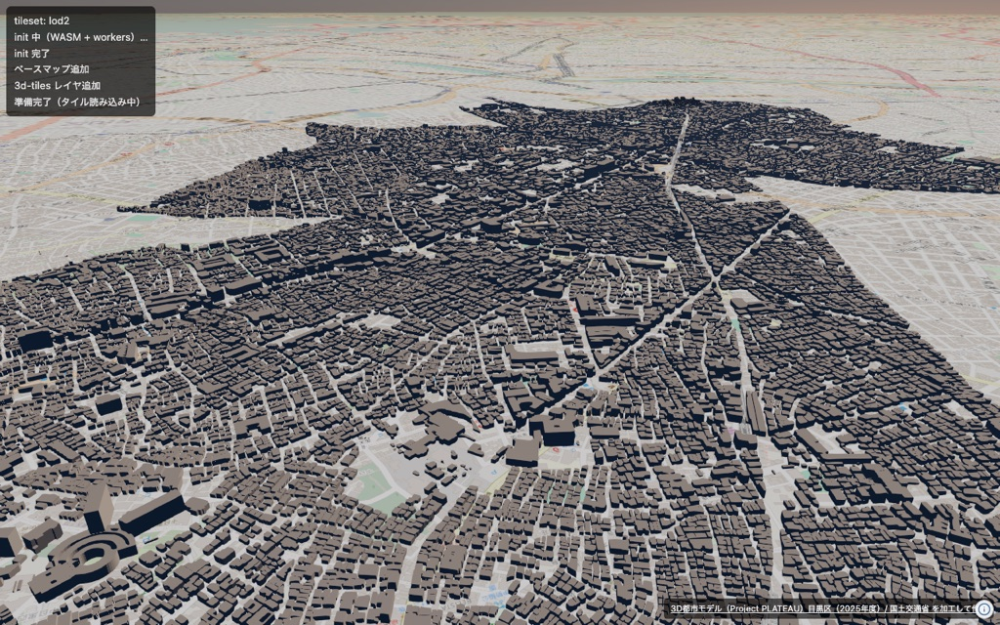
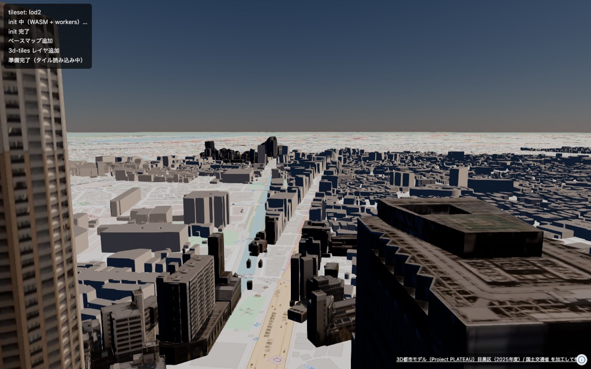
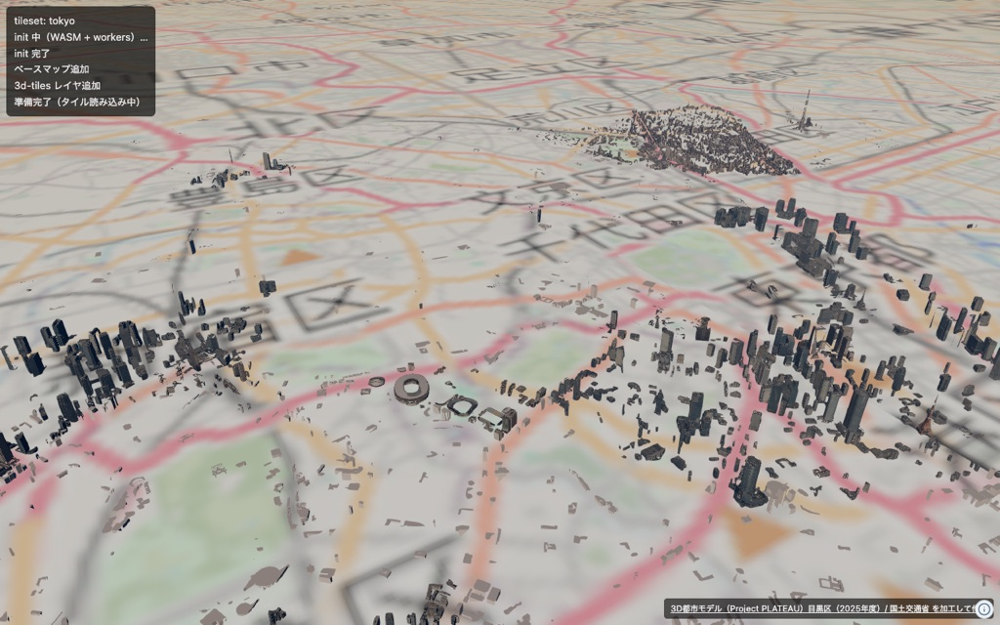

# データ準備: PLATEAU 3D都市モデル

中目黒駅周辺の建築物・道路データを、PLATEAU の CityGML から
3D Tiles と GeoJSON に変換する手順。

変換は `scripts/convert_plateau.sh` にまとめてあるので、
通常はそれを実行するだけでよい。以下はその中身と前提の説明。

> **広域の建物は自前変換を使わない。**
> 画面に出す建物は PLATEAU 配信サービスの公式3D Tilesを直接読んでいる
> （URLは `web/src/tilesets.ts`）。ここで変換した 3D Tiles は、
> 公式配信が使えなくなったときの保険という位置づけ。
> 切り替え手順は[公式配信が落ちたときの代替](#公式配信が落ちたときの代替)を参照。
> GeoJSON（`bldg.geojson` / `tran.geojson`）は日影計算の入力として引き続き使う。

公式配信を NAVARA (`@navaramap/three`) で表示したところ:

| | |
|---|---|
|  |  |
| 目黒区全域 LOD2（`13110-bldg-lod2-2025`） | 中目黒駅上空180m。テクスチャが乗っている |



東京都全域（`13-bldg-maxlod2-latest`、親1 + 子62 の複合tileset）。

## 出典

**3D都市モデル（Project PLATEAU）目黒区（2025年度）** — 国土交通省

- 配布元: https://www.geospatial.jp/ckan/dataset/plateau-13110-meguro-ku-2025
- プロジェクト: https://www.mlit.go.jp/plateau/
- 取得物: `13110_meguro-ku_pref_2025_citygml_1_op.zip`（`data/plateau/` に展開済み）
- データ作成年月日: 2026年3月13日
- 形式: CityGML 2.0 + i-UR (uro) 3.2、測地系 EPSG:6697（JGD2011 + 標高）

### ライセンス

G空間情報センターのデータセットページのライセンス欄の表記は次のとおり。

> PLATEAU Site Policy 「３．著作権について」に拠る

参照先の [PLATEAU Site Policy](https://www.mlit.go.jp/plateau/site-policy/)
「３．著作権について」が定めるライセンスは以下の4つで、
**利用者がいずれか1つを選択**して利用する（商用利用含め無償）。

- 政府標準利用規約（第2.0版）
- [クリエイティブ・コモンズ・ライセンスの表示4.0国際](https://creativecommons.org/licenses/by/4.0/legalcode.ja)（CC BY 4.0）
- [ODC BY 1.0](https://opendatacommons.org/licenses/by/1-0/)
- [ODbL](https://opendatacommons.org/licenses/odbl/)

いずれも出典表示が必要。Site Policy が示す記載例に合わせると、
このプロジェクトでは次のように表示する。

```
出典：3D都市モデル（Project PLATEAU）目黒区（2025年度）（国土交通省）
https://www.geospatial.jp/ckan/dataset/plateau-13110-meguro-ku-2025
```

> 原典資料の位置の正しさの違いや、作成された時期の違いにより、
> 現状を正確に反映していない場合があることに注意（配布元 README より）。

## 変換ツール

[PLATEAU GIS Converter](https://github.com/Project-PLATEAU/PLATEAU-GIS-Converter)
（CLI 名 `nusamai`）を使う。
**このリポジトリには含めない。** 外部のツール置き場にクローンしてビルドする。

### CLIの準備

```sh
# Rust（未インストールなら）
curl --proto '=https' --tlsv1.2 -sSf https://sh.rustup.rs | sh

# クローンしてリリースビルド
mkdir -p ~/dev/tools
git clone https://github.com/Project-PLATEAU/PLATEAU-GIS-Converter.git ~/dev/tools/PLATEAU-GIS-Converter
cd ~/dev/tools/PLATEAU-GIS-Converter
cargo build --release -p nusamai

# 出力形式の一覧を確認
./target/release/nusamai --help
```

`--sink` で選べる出力形式:
`3dtiles` / `gpkg` / `mvt` / `pmtiles` / `geojson` / `czml` / `gltf` / `kml` /
`ply` / `serde` / `shapefile` / `noop` / `minecraft` / `obj`

スクリプトはビルド結果を
`~/dev/tools/PLATEAU-GIS-Converter/target/release/nusamai` に探しに行く。
別の場所に置いた場合は環境変数 `NUSAMAI` で指定する。

## 変換範囲

目黒区全域ではなく、**中目黒駅周辺の2x2メッシュのみ**を変換する。

| メッシュコード | |
|---|---|
| 53393565 | 53393566 |
| 53393575 | 53393576 |

区全域だと bldg が28メッシュ55,638棟あり、3D Tiles の出力が数GB規模になるため絞っている。
範囲を変える場合は `scripts/convert_plateau.sh` の `MESHES` を編集する。

## 実行

```sh
scripts/convert_plateau.sh
```

やっていること:

1. **bldg 4ファイル → 3D Tiles** → `data/plateau/tiles_bldg/`

   ```sh
   nusamai --sink 3dtiles --output data/plateau/tiles_bldg \
     data/plateau/meguro/udx/bldg/5339356{5,6}_bldg_6697_op.gml \
     data/plateau/meguro/udx/bldg/5339357{5,6}_bldg_6697_op.gml
   ```

2. **bldg 4ファイル → GeoJSON** → `data/plateau/bldg.geojson`
3. **tran 4ファイル → GeoJSON** → `data/plateau/tran.geojson`

   ```sh
   nusamai --sink geojson --output <作業ディレクトリ> <入力GML...>
   ```

   注意: `geojson` sink は `--output` を**ディレクトリ**として扱い、
   地物型ごとに `Building.geojson` / `Road.geojson` を書き出す。
   単一ファイルが欲しいので、スクリプトでは一時ディレクトリに出してから
   目的のパスへ `mv` している。

   入力に複数の GML を渡すと、1つの FeatureCollection にまとめて出力される
   （メッシュごとにファイルは分かれない）。

変換時間は4メッシュ合わせて数秒程度。

## 出力と検証

スクリプトの最後に検証が走る。手で確認する場合:

```sh
test -f data/plateau/tiles_bldg/tileset.json && echo ok
python3 -c "
import json
f = json.load(open('data/plateau/bldg.geojson'))['features']
print(len(f), 'features')
print('measuredHeight:', f[0]['properties']['measuredHeight'])
"
```

実際の出力（2025年度データ、4メッシュ）:

| 出力 | 内容 |
|---|---|
| `data/plateau/tiles_bldg/` | 242MB、`tileset.json` + zoom 15〜18 の `.glb` 343個 |
| `data/plateau/bldg.geojson` | 89MB、14,334 features（MultiPolygon） |
| `data/plateau/tran.geojson` | 6.8MB、4,535 features（MultiPolygon） |

### 高さの属性

`bldg.geojson` の各 feature は `measuredHeight`（m、数値）を持つ。
14,334件すべてに入っている。階数 `storeysAboveGround` / `storeysBelowGround` も同様。

**`measuredHeight` が `-9999.0` の地物が94件ある（全体の0.66%）。**
これは PLATEAU が高さ不明を表すのに使う番兵値で、実際の高さではない。
そのまま平均を取ると -51.6m になるので、必ず判別する。
除外後の有効値は min 0.8m / max 163.3m / 平均 10.4m。

#### -9999 のときの扱い（日影計算の方針）

地物を捨てると建物が消えて日影が抜けるので、**捨てずに階数から推定する**。
ただし **`storeysAboveGround` にも `9999` という番兵値がある**ので、
階数をそのまま信じてはいけない。
実測すると `storeysAboveGround == 9999` が全体で1,352件（9.4%）あり、
`measuredHeight == -9999` の94件のうち**72件はこちらも 9999** だった。
素朴に `storeysAboveGround * 3` とすると 29,997m の建物ができてしまう。

| 条件 | 使う高さ | 印 |
|---|---|---|
| `measuredHeight > -9000` | `measuredHeight` をそのまま | なし（実測値） |
| `measuredHeight <= -9000` かつ `1 <= storeysAboveGround <= 100` | `storeysAboveGround * 3.0` m | **推定** |
| 上記以外（階数も `9999` / 欠損 / 0） | 日影計算から除外し、件数をログに出す | — |

4メッシュでの実績（計14,334件）:

| 区分 | 件数 |
|---|---|
| 実測値をそのまま使える | 14,240 |
| 階数から推定（印あり） | 22 |
| 高さを決められず除外 | 72 |

1階あたり3.0mは住宅・小規模建築物の階高の目安。
推定対象22件の階数は1〜8階なので、この範囲では妥当な近似。
高層建築物で階高が3mを超える場合は過小評価になるため、
印の付いた結果を断定的に提示しないこと。

推定で埋めた地物には必ず印を付け、UI と出力で実測値と区別できるようにする
（例: feature に `height_estimated: true` を持たせ、
日影の結果にも「推定値を含む」と表示する）。
除外した72件は**日影が実際より軽く出る**原因になるので、
「高さ不明のため除外: N棟」を結果に併記する。

```python
SENTINEL_HEIGHT = -9000   # measuredHeight: -9999 が高さ不明
MAX_PLAUSIBLE_STOREYS = 100  # storeysAboveGround: 9999 が階数不明
METERS_PER_STOREY = 3.0


def building_height(props):
    """(高さ[m], 推定フラグ) を返す。高さを決められなければ (None, None)。"""
    h = props.get("measuredHeight")
    if h is not None and h > SENTINEL_HEIGHT:
        return h, False
    storeys = props.get("storeysAboveGround")
    if isinstance(storeys, int) and 1 <= storeys <= MAX_PLAUSIBLE_STOREYS:
        return storeys * METERS_PER_STOREY, True
    return None, None
```

その他の属性（`address`、`buildingDetailAttribute`、
`buildingDisasterRiskAttribute` など）は入れ子構造のため、
**JSON文字列として格納される**。使うときは `json.loads()` でパースが必要。

## 公式配信が落ちたときの代替

**まだ実行していない。公式配信が使えなくなってから着手する手順。**

平常時、画面の建物は PLATEAU 配信サービスの公式3D Tilesを直接読んでいる。
URLは `web/src/tilesets.ts` に集約してあり、目黒区は**2025年度に固定**している
（`13110-bldg-lod2-2025`）。`latest` を使わないのは、年度更新で中身が
入れ替わると日影の計算結果や評価の再現性が崩れるため。
東京都全域の背景だけは `13-bldg-maxlod2-latest` のままでよい。

配信元は次の2ホストに依存していて、可用性のSLAは公表されていない。

- `api.plateauview.mlit.go.jp` — 親 tileset.json（複数の子を束ねるラッパー）
- `assets.cms.plateau.reearth.io` — 子 tileset.json と b3dm タイルの実体

どちらかが落ちたら、以下の手順で自前ホストに切り替える。

### 1. 公式データを落とす

**自前変換した 3D Tiles ではなく、公式が配信している目黒区のデータを使う。**
自前変換（3D Tiles 1.1 + glb、242MB）は形式が別物で、
差し替えるとローダ側の挙動まで変わってしまう。公式と同じ
3D Tiles 1.0 + b3dm のまま置き場所だけ替えるほうが影響が小さい。

使うのは `13110_bldg_lod2_no_texture`（**33.5MB**）。
テクスチャ無しを選ぶのは、容量が LOD2 テクスチャ付き（42.0MB）より小さく、
`EXT_texture_webp` への依存も外れるため。

データカタログAPIで現在のURLを引く:

```sh
curl -s https://api.plateauview.mlit.go.jp/datacatalog/plateau-datasets \
  | python3 -c "
import json,sys
for r in json.load(sys.stdin)['datasets']:
    if r.get('city_code')=='13110' and r.get('type_en')=='bldg':
        print(r['id'], r['year'], round(r['file_size']/1e6,1), r['url'])
"
```

`13110_bldg_lod2_no_texture` の行の URL が子 tileset.json。
その tileset.json と、同階層の `data/*.b3dm`（202ファイル）を丸ごと取得する。
親の tileset.json は子を1つ指すだけのラッパーなので、子を直接配信すればよい。

### 2. Cloudflare R2 に置く

バケットに `plateau/13110-bldg-lod2-notexture-2025/` のような
年度入りのプレフィックスで配置する（year-pinned の性質を保つため）。

- `tileset.json` 内の `content.uri` は `data/dataN.b3dm` の**相対パス**なので、
  ディレクトリ構造をそのまま保てば書き換え不要
- ブラウザから読むので **CORS で `Access-Control-Allow-Origin` を許可**する。
  公式配信は親子とも `*` を返している
- b3dm は `Content-Type: application/octet-stream` で返す

### 3. URLを差し替える

`web/src/tilesets.ts` を編集せず、環境変数で切り替える。

```sh
VITE_MEGURO_TILESET_URL=https://<r2-public-domain>/plateau/13110-bldg-lod2-notexture-2025/tileset.json npm run dev
```

`.env` に書いてもよい。東京都全域を差し替える場合は
`VITE_TOKYO_TILESET_URL` を使う。

出典表示は配信元に依存しないので、差し替えても変更不要
（`ATTRIBUTION` は `web/src/tilesets.ts`、画面表示は `web/index.html` の `#credit`）。
ライセンス上、自前ホストから配信する場合も出典表示は必要。

## リポジトリに入れないもの

`data/` は `.gitignore` 済み。CityGML の原本も変換後の成果物もコミットしない。
各自 `scripts/convert_plateau.sh` を実行して手元で生成する。

`web/node_modules/` も同様。`package-lock.json` はコミットする。
