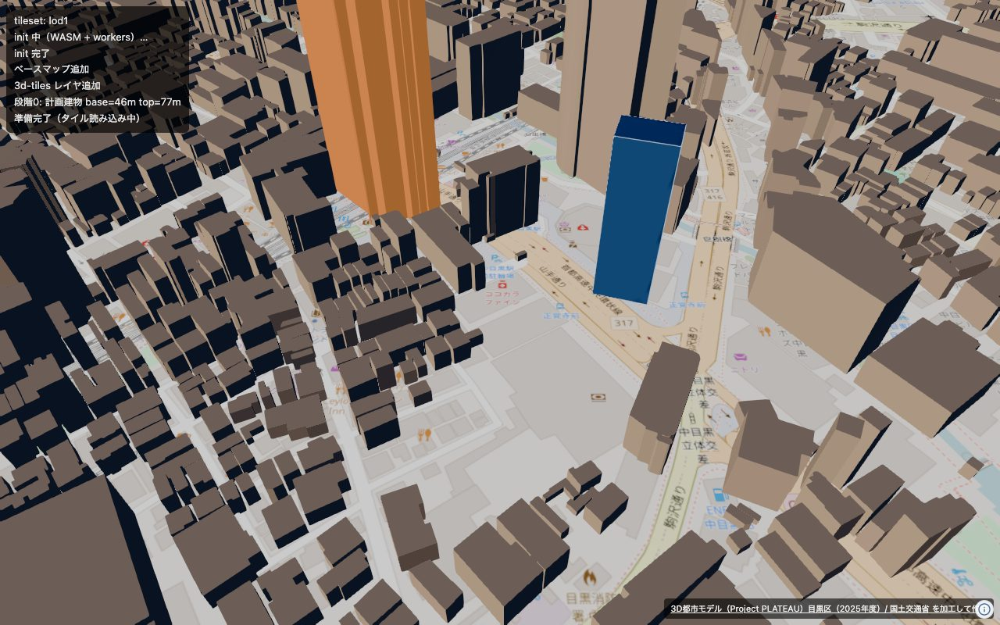
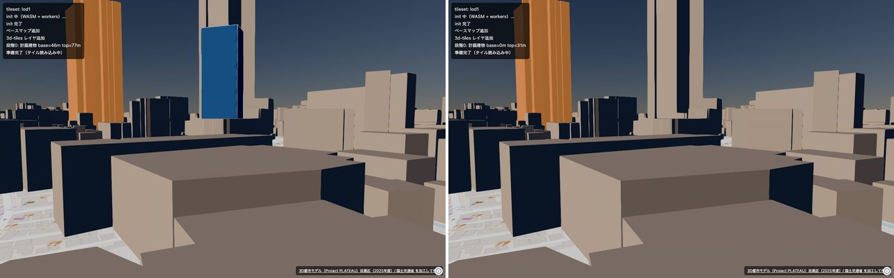
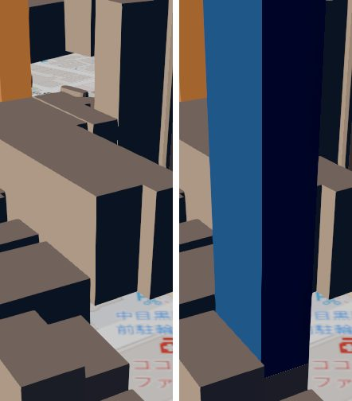

# 段階0: 計画建物（青）と解体建物（オレンジ）を3Dで重ねる

手で作った計画建物1棟を押し出して青で出し、公式3D Tilesの既存建物1棟を
オレンジに塗り替えられるかを確かめた。コードは `web/src/stage0.ts`。

```sh
cd web && npm run dev
# http://localhost:5173/?set=lod1&stage=0
```

| URL | 中身 |
|---|---|
| `?stage=0` | 計画建物（青）＋解体建物（オレンジ） |
| `?stage=0&baseZ=0` | 基準面を間違えた場合（建物が地中に沈む） |
| `?stage=0&overlap=1` | 計画建物を既存建物と同じ輪郭に立ててZファイティングを見る |
| `?stage=0&planned=0` | 青だけ出さない（撮り比べて差分を取るため） |



左の高いのが解体側（オレンジに塗り替えた既存建物）、右が計画建物（青）。
どちらも**位置も規模も仮**で、届出のデータではない。

---

## 1. 基準面 — 楕円体高で置く。標高で置くと36.7m沈む

**NAVARAに渡す高さは楕円体高**（WGS84楕円体からの高さ）。
PLATEAU公式配信の3D Tilesも楕円体高で描かれている。
一方、CityGMLの原データの高さは**標高**（T.P.、東京湾平均海面から）で、
目黒区ではこの差（ジオイド高）が **約36.7m** ある。

中目黒周辺の895棟で実測した:

| | |
|---|---|
| `bldg.geojson` の底面Z － b3dmのバッチテーブル `_zmin` | **36.708 m** |
| 標準偏差 / 最小 / 最大 | 0.045 / 36.597 / 37.427 |
| 照合できた棟数 | 895 / 895 |

つまり:

- **`bldg.geojson` のZはそのまま使ってよい。** nusamai が楕円体高に変換済みで、
  公式3D Tilesの描画位置と一致する。
- **b3dmのバッチテーブルの `_zmin` / `_zmax` は地面の決定に使ってはいけない。**
  これは原データの標高がそのまま入っている属性で、描画位置より36.7m低い。
- 中目黒駅周辺の地面は楕円体高で**約46m**（標高では約9m）。



左が `baseZ=46`（正しい）、右が `baseZ=0`。同じカメラ・同じ建物で、
右は31mの建物がまるごと見えなくなっている。
ジオイド高を忘れると「建物が出ない」という形で失敗する。

## 2. Zファイティング — 起きなかった

計画建物を既存建物（11.8m）とまったく同じ輪郭・同じ底面高に立て、
下から11.8m分の壁を公式3D Tilesの壁と完全に重ねた。



左が公式3D Tilesだけ、右が同じ輪郭に計画建物を立てたもの。

同じカメラで撮り比べて差分を取ったところ:

| | |
|---|---|
| 計画建物のピクセル | 60,452 |
| うち、もともと建物が写っていた（壁が重なっている）部分 | 40,657 |
| その重なり部分が計画建物の青で描かれた割合 | **98.9%** |

残り1.1%は輪郭線と輪郭のアンチエイリアスで、縞模様は出ていない。
**計画建物が手前に出る**ので、解体→新築で輪郭が重なっても今のところ問題はない。
深度の精度はカメラの near/far に依存するので、カメラを変えたら見直すこと。

## 3. featureUpdated — タイルが来るたび、タイル内の全地物に対して発火する

`gml_id` で既存建物を選んでオレンジにした。`gml_id` は b3dm のバッチテーブルにも
`bldg.geojson` の `properties.id` にも同じ形（`bldg_<UUID>`）で入っていて、
**これが計算用のGeoJSONと表示用の3D Tilesをつなぐ鍵**になる。

目黒区LOD1を中目黒上空から見たときの実測:

| | |
|---|---|
| 読み込まれたb3dm | 51 |
| `featureCreated` の発火回数 | 51（＝タイル1枚に1回） |
| `featureUpdated` の発火回数 | 153（＝タイル1枚につき3回） |
| `evaluate` で見た `gml_id` の延べ数 | 29,040 |
| 目的の1棟を塗った回数 | 20 |
| レイヤ追加から最初に塗れるまで | **約2.1秒** |

分かったこと:

- 発火は**タイル単位**で、コールバックの中の `evaluate()` は
  そのタイルに入っている**全地物**をなめる。だから「1棟だけ塗る」つもりでも
  延べ29,040回の判定が走る。`evaluate(..., { filters: ["gml_id"] })` で
  読む属性を絞らないと、1棟あたり数十項目のJSONを毎回展開することになる。
- 同じ1棟が20回塗られるのは、LODの階層で同じ建物が複数のタイルに入っているため。
  **塗る処理は何度呼ばれてもいいように書く**（べき等にする）。
- タイルは後からも読み込まれるので、**最初の1回だけ塗る作りにしてはいけない**。
  `featureCreated` と `featureUpdated` の両方を購読する。
- 色を変えるのに `forceUpdate()` は要らなかった。
  必要になるのは、塗る条件のほうを後から変えるとき。

---

## まだ分かっていないこと

- **背景の地図（OSMラスタ）がどの高さに敷かれているか。**
  計画建物の底面高を4m〜46mまで振って見え方を測ったが、
  地面に隠れているのか手前の建物に隠れているのかを分離できなかった。
  日影を地上1.5mで出すときに必要になるので、そこで決める。
- 影（`castShadow`）は有効にしてあるが、見え方は確認していない。
- LOD2（テクスチャ付き）で色の塗り替えがどう見えるかは未確認。段階0はLOD1で確かめた。
