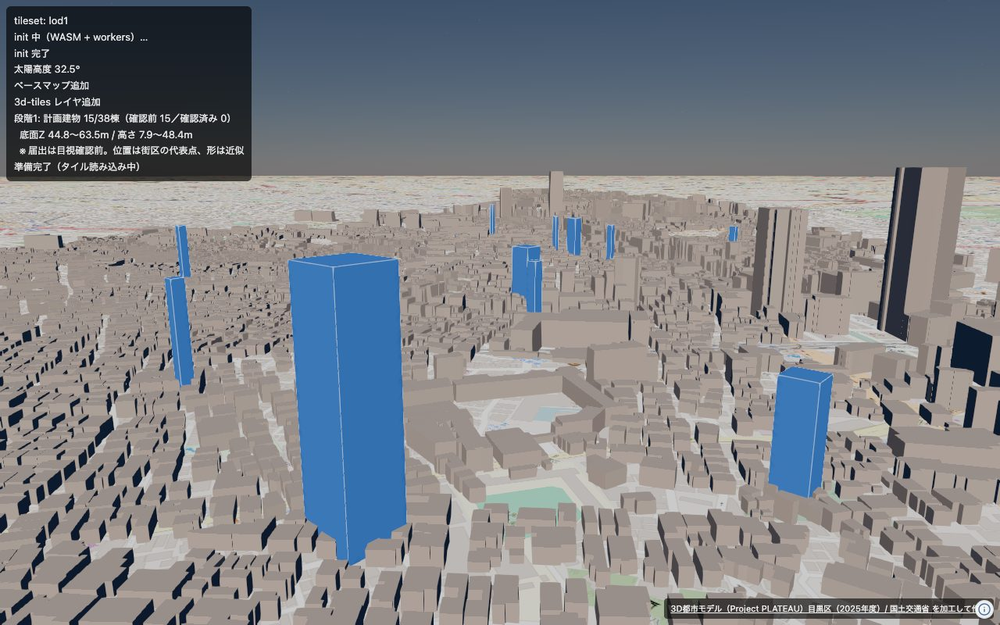
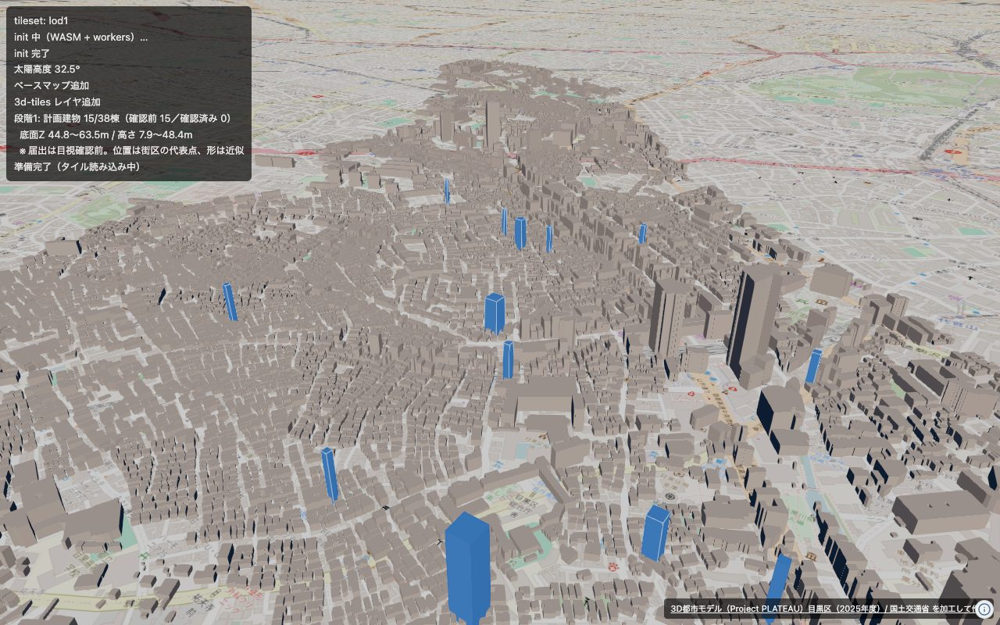

# 段階1: 届出から計画建物（青）を立ち上げる

段階0は手で作った1棟だったが、ここは**届出のデータ**から立ち上げる。
作るのは `pipeline/make_planned_geojson.py`、出すのは `web/src/stage1.ts`。

```sh
source .venv/bin/activate
python pipeline/make_planned_geojson.py     # → data/planned/planned.geojson
cd web && npm run dev
# http://localhost:5173/?set=lod1&stage=1&time=10
```

| URL | 中身 |
|---|---|
| `?stage=1` | 中目黒駅から800m以内の計画建物 |
| `?stage=1&radius=0` | 絞らずに全部 |
| `?stage=1&time=10` | 現地の視太陽時を10時にする（下記） |



中目黒駅の周りの計画建物。半透明の青が**まだ目視確認していない**届出の値。
灰色は公式3D TilesのPLATEAU（2021年調査）。



---

## 1. 何から何を作ったか

| | 出どころ |
|---|---|
| 位置 | 街区レベル位置参照情報（目黒区2025年版）の**代表点**。`代表フラグ=1` |
| 形 | 建築面積と同じ面積の**正方形**。北向き |
| 高さ | 「3D表示に使う高さ」＝最高の高さがあればそれ、なければ高さ |
| 底面 | 近くの既存建物の底面Zの中央値（**楕円体高**） |

底面は、半径60m → 120m → 250m → 500m と広げて、最初に3棟そろった半径で決める。
遠くから取ったもの（120m超）は `base_z_rough: true` を立てる。
目黒区は起伏があるので、遠い地面はそのまま信じられない。

出した38棟の底面Zは **42.4〜67.4m**（楕円体高）。
中目黒駅周辺の約46mという段階0の実測と合う。

## 2. 届出68件のうち、立ったのは38件

残り30件は **`bldg.geojson` の範囲の外**で落ちた。
`bldg.geojson` は目黒区の全域ではなく、撮影ルートの4メッシュ
（53393565・66・75・76）だけを変換したものだから（dev-policy §6）。

```
範囲 緯度 35.6333〜35.6500 / 経度 139.6875〜139.7128
```

自由が丘・碑文谷・柿の木坂などは丸ごとこの外にある。
広げるなら `scripts/convert_plateau.sh` にメッシュを足す。
**地面の高さを推測で埋めてはいけない**ので、今は落とすほうを選んだ。

## 3. 「が丘」と「ヶ丘」

位置参照情報は **「自由が丘」「緑が丘」「東が丘」**と書くが、
届出は「緑ヶ丘」と書いていた。そのままでは街区の代表点が引けない。

そろえる処理は1か所だけという決まり（dev-policy §4）に従って、
`pipeline/normalize.py` の `text()` に `が丘 → ヶ丘` を足した。
看板側と届出側の両方が同じ規則で通るので、評価の数字もずれない。

## 4. 夜に開くと建物が真っ黒になる

**これで1時間溶かした。** 3D Tilesもこちらの押し出しも描かれているのに
真っ黒で、地図のラスタだけが見えるので「タイルが出ていない」ように見える。
ラスタは照明を受けないが、3Dのジオメトリは太陽光で陰影が付くため。

`view.atmosphere` が太陽の位置を持っていて、既定は**今の時刻**。
22時に開けば当然、夜になる。

```ts
view.atmosphere.setSolarTime({ lng: 139.6989 }, 10); // 現地の視太陽時10時
view.atmosphere.getSunElevation({ lng, lat });       // 負なら夜
```

`?time=10` を足し、太陽高度をHUDに出して、負のときは断りを書くようにした。
日影（冬至、dev-policy §10）もこの仕組みの上に載せる。

## 5. 確認前の印

届出はまだ**1件も目視確認が済んでいない**（`verified` 列が全部空）。
確認前の棟は半透明（`opacity: 0.55`）、確認済みになったら濃く（`0.95`）なる。
`filings_extracted.csv` の `verified` に 1 を入れれば自動で切り替わる。

GeoJSON 自身にも断りを持たせてある:

```json
"metadata": {
  "count": 38, "confirmed": 0, "unconfirmed": 38,
  "note": "届出の読み取り結果。目視確認が済んでいない行は「確認前」。…"
}
```

**建築物の名称は入れていない。**「○○様邸」のように個人名が入るため（dev-policy §4）。

## 6. `data/` を dev サーバーだけが配る

`planned.geojson` は `data/` の下に出す（`data/` はリポジトリに入れない）。
`web/vite.config.ts` に、**開発中だけ** `/data/…` の **`.geojson` に限って**
配るミドルウェアを入れた。届出のPDFや写真はこの経路でも出ない。

```
/data/planned/planned.geojson     → 200 application/geo+json
/data/meguro/filings_extracted.csv → index.html にフォールバック（配らない）
/data/../../etc/hosts.geojson      → index.html にフォールバック（配らない）
```

**公開用のデプロイでは別の置き方が要る。** まだ決めていない（dev-policy §9・§14）。

---

## まだやっていないこと

- **形を最寄りの道路に沿わせる**（dev-policy §5）。今は北向きの正方形のまま。
  `data/PLATEAU/tran.geojson`（道路LOD1）があるので、そこから向きを取れる。
- 街区の中のどこに建つかは分からない。代表点に置いているだけ。
  既存建物と重なった棟がいくつかあるが、段階0でZファイティングは出ないと
  確かめてあるので描画は壊れない。
- 解体側（オレンジ）を解体名簿の住所から特定する。
- `bldg.geojson` の範囲を目黒区全域に広げるか、落とした30件をどう見せるか。
