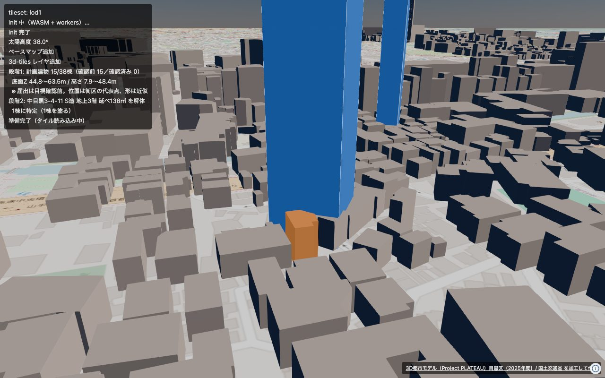
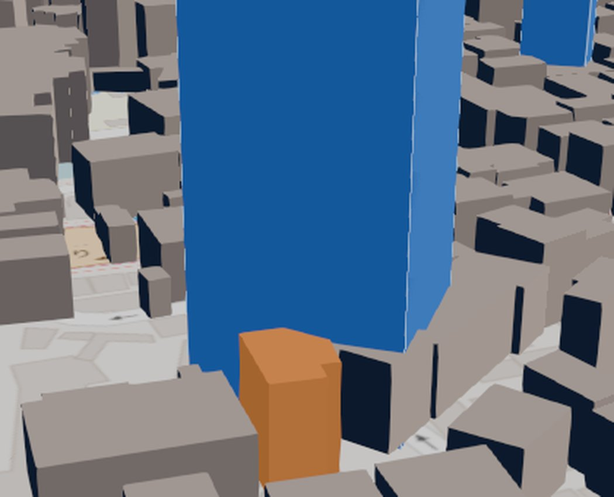

# 段階2: 解体される建物をオレンジにする

解体工事等標識設置届の名簿から、壊される建物を PLATEAU の中で特定して
色を変える。作るのは `pipeline/make_demolition_geojson.py`、
出すのは `web/src/stage2.ts`。

```sh
source .venv/bin/activate
python pipeline/make_demolition_geojson.py 中目黒3-4-11   # → web/public/demolition.json
python pipeline/make_demolition_geojson.py --scan        # 1棟に決まる場所を探す
cd web && npm run dev
# http://localhost:5173/?stage=2&time=11
```





オレンジが解体される建物（中目黒3-4-11、S造3階）、青がこれから建つ計画建物。
灰色は公式3D TilesのPLATEAU。

---

## 1. 名簿から取るもの・取らないもの

名簿には**工事業者の名称と住所が載っているが、取らない**（dev-policy §4）。
読むのは 種類・場所・構造・階数・床面積・工期だけ。
書き出す前に「株式会社」「（株）」などが混ざっていないかも確かめている。

「特定建設」だけの行は解体ではない（新築や改修の工事）ので除く（dev-policy §6）。
770件が残る。

## 2. 号の位置が無いので、街区の中で絞る

住居表示の「号」を座標にする手段がない（dev-policy §15）。
だから街区レベル位置参照情報で**街区**までしか分からず、
そこから先は**街区の中の候補を順位付け**する:

| 手がかり | 使い方 |
|---|---|
| 階数 | 名簿の階数と、PLATEAUの階数／高さから見積もった階数を比べる |
| 床面積 | 名簿の延べ面積 ÷ 階数 ≒ 建築面積 として、PLATEAUの底面と比べる |
| 耐火性能 | SRC造・RC造・S造なら耐火のはず。準耐火なら強く下げる |
| 距離 | 街区の軸（位置参照情報の点）からの距離 |

1位が十分よく、かつ2位と差がついているときだけ `confident: true` にする。
**false のときは1棟に決めない。** 画面でも候補を薄く並べる
（dev-policy §2「決めきれなければ候補として複数を薄く示す」）。

## 3. PLATEAUの階数は当てにならない

高さ30.8mの建物に `storeysAboveGround: 2` が入っている例があった。
階数だけで絞ると落とすので、**高さから見積もった階数**（1階2.6〜4.6m）と
どちらか近いほうを採る。

`fireproofStructureType` は「耐火」「準耐火造」「その他」の3通りで、
**SRC造とRC造とS造は区別できない**。しかも「準耐火」は「耐火」を文字として
含むので、部分一致で見ると準耐火を耐火と取り違える（一度やった）。

PLATEAUに延べ面積は無い（`buildingRoofEdgeArea` ＝ 底面だけ）。
住所は町丁目までしか入っていないので、号の照合には使えない。

## 4. 中目黒3-5-8 は決められなかった

最初に狙ったのはここ（SRC造7階・延べ798.4㎡を解体して、
同じ住所に9階建て33mの事務所＝届出No.17が建つ）。
**1棟に決まらなかったので、オレンジにしていない。**

| | 街区5番の周り |
|---|---|
| 代表点(南)から45m以内 | 1〜3階の住宅ばかり。最高6.8m |
| もう1点(北)から45m以内 | 3〜5階。最高21.4m |
| 7階・SRC・底面114㎡ | **街区の中に無い** |

上位候補はすべて街区の軸から47〜52m離れ、座標を見ると全部が軸の東側に
固まっていた。道路を挟んだ**隣の街区**を拾っている可能性が高い。
この街区は位置参照情報の点が2つあって89m離れており、長い街区の
どこに「8号」があるかが分からない。

号の位置が無いとここまでしか絞れない、という実例として残す。

## 5. 決まる場所を探した

`--scan` で名簿770件を総当たりし、**1棟に決まったものが11件**。
そのうち計画建物（青）に一番近い **中目黒3-4-11** を採った。

```
中目黒3-4-11  S造3階 延べ138.0㎡
  → bldg_15952ac4-…  score 0.88（2位 6.49）
     3階 / 高さ10.8m / 底面46.3㎡ / 耐火 / 住宅
     延べ138.0 ÷ 3階 = 46.0㎡ に対して底面46.3㎡（1%ずれ）
     街区の軸から16m
  青（届出No.68、中目黒三丁目4番）まで16m
```

**ただし決め手は耐火性能だけ。** 2位（`bldg_c72eb7c0-…`）は
3階・底面46.2㎡・軸から9mで、**形も階数もほぼ同じ**。
分けているのは「S造なら耐火、PLATEAUでは準耐火造」の1点しかない。
現地で確かめていないので、ここは弱いまま。

---

## まだやっていないこと

- 現地（または写真のGPS）での裏取り。今は属性の一致だけで決めている
- 中目黒3-5-8 のように決まらない件を、画面でどう見せるか
- 解体と新築を**同じ敷地のものとして結びつける**処理。
  今は「近くにある」だけで、同じ土地かどうかは見ていない
